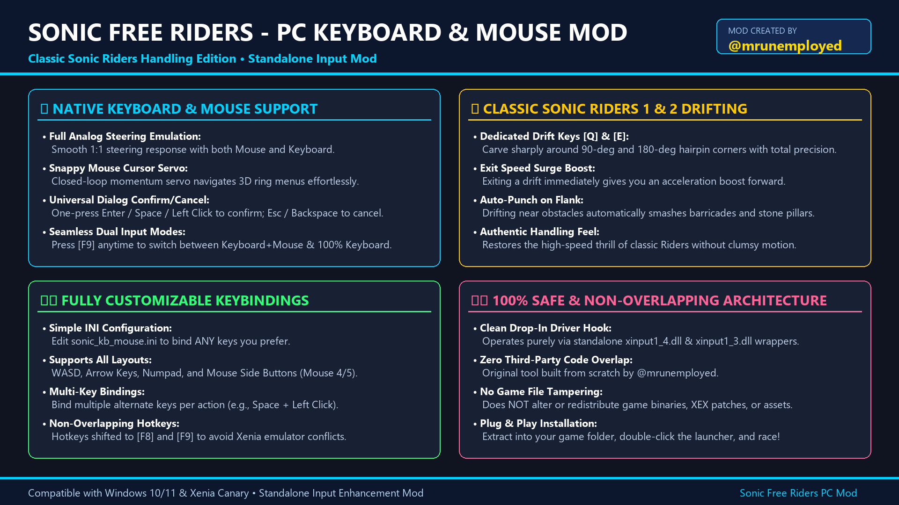
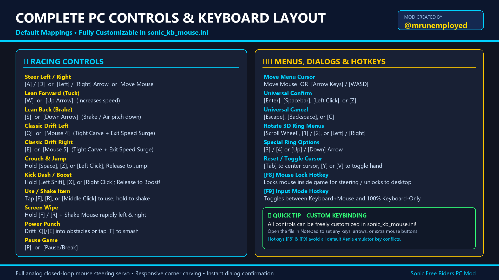
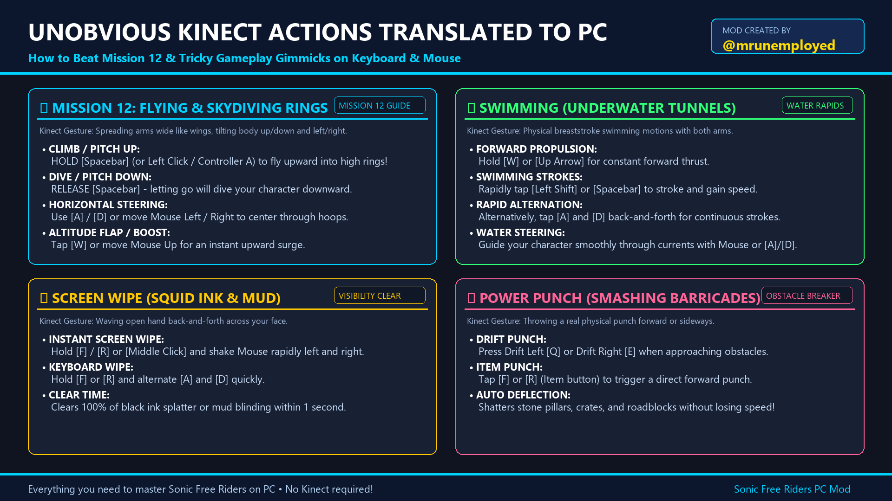

# Sonic Free Riders – PC Keyboard & Mouse Mod
### Classic Riders Handling Edition · v1.0 · by **@mrunemployed**

A drop-in XInput wrapper (`xinput1_4.dll` / `xinput1_3.dll`) that gives **Sonic Free Riders** (Xbox 360, played on **Xenia Canary**) full keyboard & mouse controls — no Kinect, no gamepad needed.



## Features
- **Native keyboard & mouse** – analog steering from the mouse or keys.
- **Classic Sonic Riders 1 & 2 drifting** – dedicated Drift Left **[Q]** / Drift Right **[E]** for tight hairpin carving, with a speed surge on drift exit.
- **Closed-loop mouse servo** for the 3D ring menus – fast cursor that doesn't lag or get stuck.
- **Universal confirm / cancel** on every prompt – Enter / Space / Left Click and Escape / Backspace / C.
- **Fully rebindable** in `sonic_kb_mouse.ini` – letters, arrows, numpad, F-keys, Mouse 4/5.
- **Hotkeys that don't clash with Xenia** – **[F8]** mouse lock, **[F9]** Keyboard+Mouse ⇄ Keyboard-Only.
- **Clean & legal** – 100% original code. Ships **no** game files, no Xenia binaries, no third-party patches.

## Download
Grab the ready-to-use ZIP from **[Releases](../../releases/latest)**.

## Installation
1. Have Sonic Free Riders running in **Xenia Canary** (your own legally dumped copy).
2. Copy `xinput1_4.dll`, `xinput1_3.dll` and `sonic_kb_mouse.ini` into the folder that contains `xenia_canary.exe`.
3. Start with `Play_Sonic_Free_Riders.bat` (or launch Xenia as usual).
4. Press **F9** to switch input mode and **F8** to lock/unlock the mouse.

> The launcher expects `xenia_canary.exe` and `default-DLLLoaderBase.xex` in the same folder; edit the last line of the `.bat` if your setup differs.

## Default controls



### Racing
| Action | Keyboard | Mouse |
|---|---|---|
| Steer left / right | `A` / `D` or `←` / `→` | Move mouse |
| Lean forward (tuck / accelerate) | `W` or `↑` | – |
| Lean back (brake / air pitch) | `S` or `↓` | – |
| **Drift left** (carve + boost exit) | `Q` or `Ctrl`+`A` | Mouse 4 |
| **Drift right** (carve + boost exit) | `E` or `Ctrl`+`D` | Mouse 5 |
| Crouch (hold) / Jump (release) | `Space` or `Z` | Left click |
| Kick dash (hold) / Boost (release) | `Left Shift` or `X` | Right click |
| Use item (tap) / Shake item (hold) | `F` or `R` | Middle click |
| Screen wipe | Hold `F`/`R` + `WASD` | Hold middle + shake mouse |
| Tag mode (hold hands) | `T` or `Left Alt` | – |
| Pause | `P` or `Pause` | – |

### Menus & dialogs
| Action | Keys |
|---|---|
| Confirm | `Enter`, `Space`, `Z`, Left click |
| Cancel / back | `Esc`, `Backspace`, `C` |
| Move cursor | Mouse, arrows, `WASD`, `I` `J` `K` `L`, numpad |
| Rotate 3D ring | Mouse wheel, `1` / `2`, `←` / `→` |
| Special options | `3` / `4`, `↑` / `↓` |
| Reset cursor | `Tab` |
| Toggle cursor | `Y` or `V` |

### Hotkeys
| Key | Action |
|---|---|
| `F8` | Toggle mouse lock (cursor inside window ⇄ free) |
| `F9` | Toggle input mode (Keyboard+Mouse ⇄ Keyboard-Only) |

## Kinect-only moves on PC



| Kinect motion | On PC |
|---|---|
| Flying / skydiving (Mission 12, ring flights) | Hold `Space` to climb, release to dive, `A`/`D` to bank, tap `W` to flap, `S` to steady |
| Swimming | Hold `W`, tap `Shift`/`Space` (or alternate `A`/`D`) for strokes |
| Wiping squid ink / mud | Hold `F`/`R` (or middle click) and shake the mouse or alternate `A`/`D` |
| Power punch (barricades, pillars) | `Q` / `E` on that side, or tap `F`/`R` |
| Ramp trick jump | Hold `Space` before the lip, release right at the edge |
| Kick dash | Tap `Shift` / `X` / right click |

Full details are in [`docs/README.txt`](docs/README.txt).

## Configuration
Edit `sonic_kb_mouse.ini` next to the DLLs. Multiple keys per action are comma-separated:
```ini
steer_left  = A, LEFT
drift_left  = Q, MOUSE_4
jump_crouch = SPACE, Z, MOUSE_LEFT
```
Mouse sensitivity, default input mode and the hotkeys are in the `[Controls]` and `[Hotkeys]` sections. If the file is missing, the mod recreates it with defaults.

## Building from source
Requires **MinGW-w64 (x86_64)**, e.g. MSYS2 `mingw-w64-x86_64-gcc`:
```bat
build.bat
```
or manually:
```bat
g++ -shared -O2 -static -static-libgcc -static-libstdc++ -o xinput1_4.dll src\xinput_kb_mouse.cpp src\xinput.def -luser32
copy xinput1_4.dll xinput1_3.dll
```
The DLL forwards all real controller calls to the system `xinput1_4.dll`, so a connected gamepad still works.

## Repository layout
```
src/        xinput_kb_mouse.cpp, xinput.def
config/     sonic_kb_mouse.ini (defaults)
launcher/   Play_Sonic_Free_Riders.bat
docs/       README.txt, images/
build.bat
```

## Credits
- **@mrunemployed** – design, code, input tuning and documentation.
- Sonic the Hedgehog and Sonic Free Riders © SEGA. Xenia Canary © the Xenia team.

Non-commercial fan tool. Not affiliated with SEGA or Microsoft. Source code released under the [MIT License](LICENSE).
